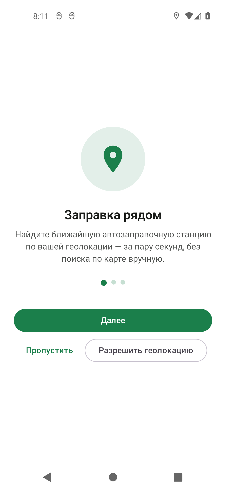
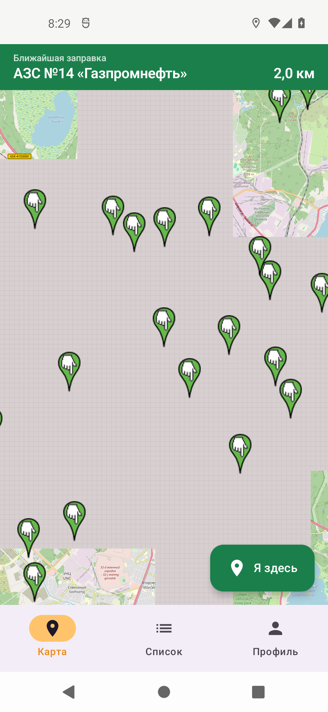
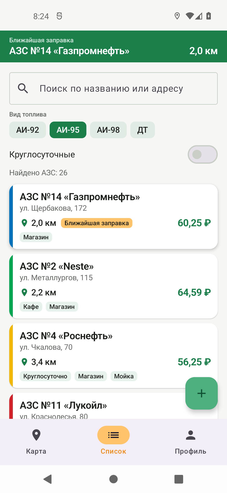
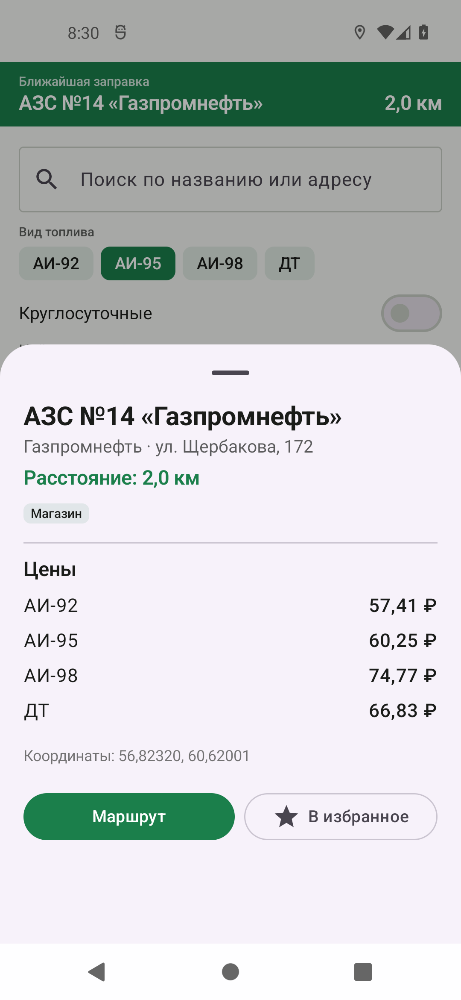
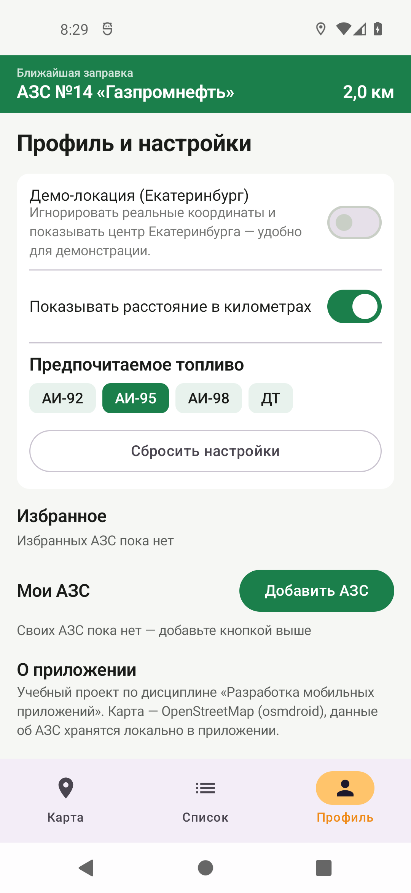

# Заправка рядом

Учебный Android-проект по дисциплине **«Разработка мобильных приложений»**.
Тема первого проекта поиск ближайшей заправки по геолокации.

Приложение определяет текущее местоположение и показывает автозаправочные станции,
отсортированные по расстоянию, — на карте OpenStreetMap и в списке.

---

## Скриншоты

Все снимки сделаны с работающего приложения на эмуляторе Pixel 5 (Android 12, API 31).

**Онбординг** — три шага при первом запуске:



**Карта** — OpenStreetMap (osmdroid) с метками АЗС и меткой «Я здесь»; в шапке — ближайшая заправка:



**Список** — сортировка «сначала ближайшие», поиск и фильтр по виду топлива:



**Карточка АЗС** — цены по всем видам топлива, удобства, кнопки «Маршрут» и «В избранное»:



**Профиль и настройки** — демо-локация, предпочитаемое топливо, избранное, свои АЗС:



**Демо-видео** (45 секунд) — проход по основным экранам приложения:

[▶ Смотреть демо-видео](docs/demo.mp4)

---

## Материалы проекта

- [Отчёт по проекту](<docs/Отчёт — Заправка рядом.docx>) — 8 разделов требуемой структуры, 17 таблиц, расчёты и метрики
- [Презентация к защите](<docs/Заправка рядом — презентация.pptx>) — 22 слайда
- Тексты выступления по ролям — [мобильный разработчик](<docs/выступления/Выступление — мобильный разработчик.md>), [дизайнер UI/UX](<docs/выступления/Выступление — дизайнер UI-UX.md>), [бэкенд-разработчик](<docs/выступления/Выступление — бэкенд-разработчик.md>), [проджект-менеджер](<docs/выступления/Выступление — проджект-менеджер.md>)

---

## Что умеет (MVP)

1. **Определение местоположения** — через `FusedLocationProviderClient`, с запросом
   разрешения и корректной обработкой отказа.
2. **Карта** — OpenStreetMap (osmdroid) с метками АЗС и меткой «Я здесь».
3. **Поиск ближайшей АЗС** — расстояние по формуле гаверсинусов, сортировка
   «сначала ближайшие», ближайшая вынесена в шапку экрана.
4. **Список АЗС** — с расстоянием, поиском по названию/адресу/бренду.
5. **Карточка АЗС** — адрес, цены по видам топлива, удобства, координаты,
   кнопка «Маршрут» (открывает внешние карты через неявный Intent).
6. **Добавление своей АЗС** — форма с валидацией, запись сохраняется локально.
7. **Настройки и избранное** — демо-локация, предпочитаемое топливо, избранные АЗС;
   всё хранится в `SharedPreferences` и реактивно обновляет интерфейс через `Flow`.
8. **Онбординг** — три экрана при первом запуске (факт прохождения сохраняется).

## Стек

| Слой | Технология | Почему |
|---|---|---|
| Язык | **Kotlin 2.4.21** | современный стандарт для Android, безопасная работа с null |
| UI | **Jetpack Compose** (BOM 2026.09) | декларативный UI без XML-разметки, как требует задание |
| Архитектура | **MVVM** | разделение UI и логики: ViewModel не знает про View, View не знает про SharedPreferences |
| Карта | **osmdroid 6.1.18** (OpenStreetMap) | не требует API-ключа и биллинга, работает офлайн-кэшем |
| Геолокация | **play-services-location 21.0.1** | FusedLocationProviderClient даёт лучшую точность и экономию батареи |
| Хранение | **SharedPreferences** | небольшие объёмы «ключ-значение»: настройки, избранное, свои АЗС (JSON) |
| Сборка | **Gradle 9.8.1 + AGP 9.4.1**, Kotlin DSL | актуальный стек Android Studio 2026.1 |
| minSdk / targetSdk | **24 / 36** | API 24 («Nougat») охватывает ~96% устройств (значение из методички) |

> **Про `osmdroid-wms`.** В методичке рядом с `osmdroid-android` указана библиотека
> `osmdroid-wms`. Она нужна только для подключения WMS-слоёв и в этом проекте
> не используется — растровые тайлы OpenStreetMap приходят через `osmdroid-android`.
> Лишняя зависимость не подключена сознательно: она увеличивает размер APK,
> не давая функциональности.

## Архитектура

```
app/src/main/java/com/example/gasfinder/
├── MainActivity.kt              точка входа, только тема + корневой composable
├── GasFinderApplication.kt      инициализация osmdroid (User-Agent, кэш тайлов)
├── data/
│   ├── FuelType.kt              виды топлива
│   ├── GasStation.kt            модель АЗС + RankedStation (АЗС + расстояние)
│   ├── GasStationRepository.kt  локальный справочник на 26 АЗС
│   ├── PreferencesRepository.kt обёртка над SharedPreferences + Flow
│   └── CustomStationStore.kt    АЗС пользователя (JSON в SharedPreferences)
├── location/
│   └── LocationProvider.kt      FusedLocationProvider → Flow<UserLocation>
├── util/
│   └── Geo.kt                   формула гаверсинусов, форматирование
├── viewmodel/
│   └── GasFinderViewModel.kt    состояние экрана и вся логика
└── ui/
    ├── GasFinderApp.kt          навигация, нижняя панель, шапка
    ├── components/StationCard.kt
    ├── screens/                 Onboarding, Map, List, AddStation, Profile, Detail
    └── theme/                   Color.kt, Theme.kt, Type.kt
```

Поток данных односторонний: `SharedPreferences`/геолокация → `Flow` → `ViewModel` →
`StateFlow<GasFinderUiState>` → Compose. Интерфейс не меняет данные напрямую,
а только вызывает методы ViewModel.

## Сборка и запуск

```bash
# 1. Убедиться, что путь к SDK прописан в local.properties
#    sdk.dir=C\:\\Android\\Sdk

# 2. Собрать debug-APK
./gradlew assembleDebug
# результат: app/build/outputs/apk/debug/app-debug.apk

# 3. Запустить unit-тесты
./gradlew test

# 4. Установить на подключённое устройство или эмулятор
./gradlew installDebug
```

Либо просто открыть папку проекта в Android Studio и нажать **Run** (Shift + F10).

### Эмулятор и демонстрационная локация

Справочник АЗС привязан к Екатеринбургу. Чтобы на эмуляторе «ближайшая» АЗС была
действительно ближайшей, задайте координаты (обратите внимание: **сначала долгота**):

```bash
adb emu geo fix 60.6057 56.8389
```

Если координаты не заданы или устройство находится далеко от справочника,
приложение автоматически переходит на демонстрационную точку (центр Екатеринбурга)
и сообщает об этом в шапке. Этот же режим можно включить вручную:
**Профиль → Демо-локация**.

## Данные

Справочник АЗС (`GasStationRepository.kt`) хранится прямо в приложении: 26 записей
с реальными названиями улиц Екатеринбурга и правдоподобными ценами. Адреса и
координаты **сгенерированы** — это учебные данные. Локальное хранение даёт офлайн-режим
и гарантирует, что демонстрация не зависит от доступности внешних API.

## Разрешения

| Разрешение | Зачем |
|---|---|
| `INTERNET`, `ACCESS_NETWORK_STATE` | загрузка тайлов OpenStreetMap |
| `ACCESS_FINE_LOCATION`, `ACCESS_COARSE_LOCATION` | определение местоположения |
| `WRITE_EXTERNAL_STORAGE` (maxSdkVersion 28) | кэш тайлов на Android 9 и ниже |

## Что дальше (после MVP)

Онлайн-цены через API, push-уведомления о снижении цен, офлайн-карты, авторизация
и синхронизация, отзывы и рейтинги АЗС, история поездок и расход топлива,
виджет «ближайшая заправка», голосовой поиск, маршрут внутри приложения,
выбор оформления.

## Лицензия

Учебный проект. Картографические данные — © участники OpenStreetMap (ODbL).
